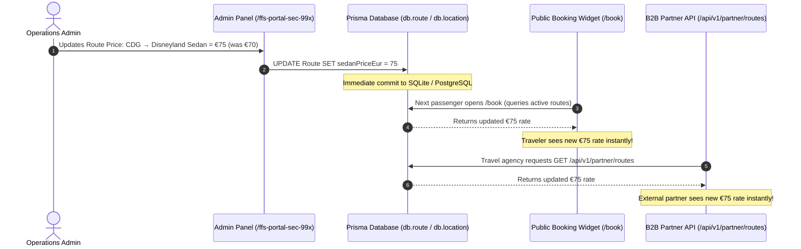
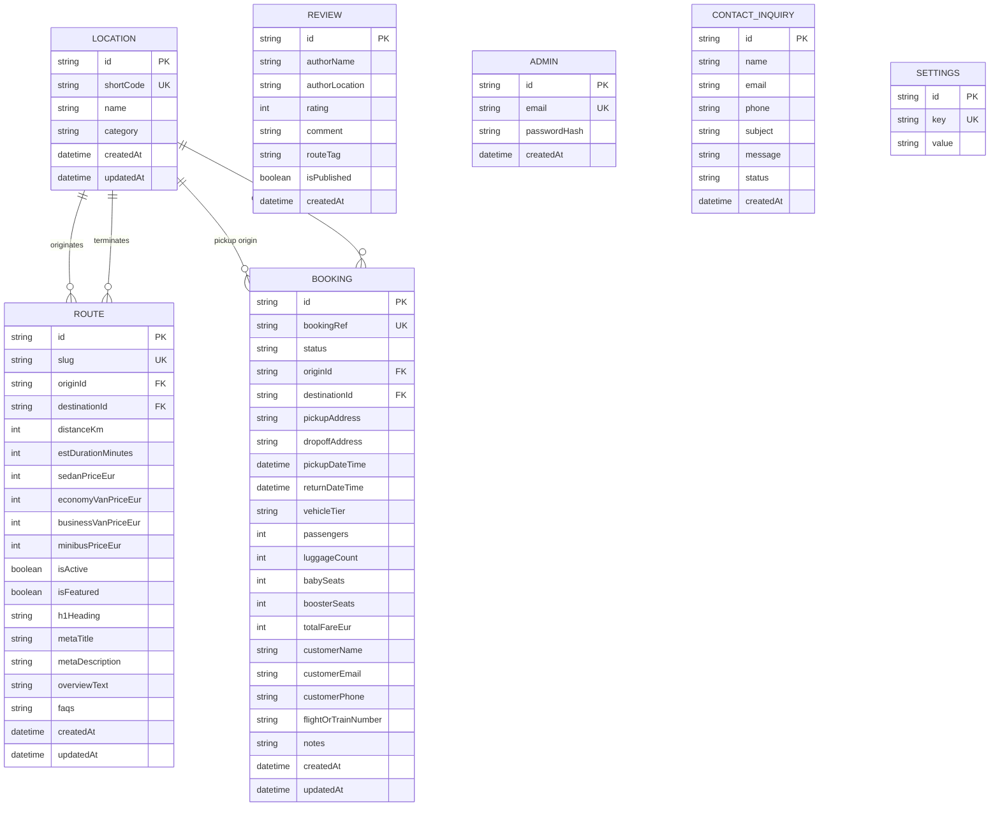

# FranceGo (FastForward Shuttle) - Complete Website Working & Architecture Manual

This comprehensive guide details the complete end-to-end architecture, user journeys, automated dispatch pipelines, dynamic admin management engine, B2B partner gateway, and security infrastructure for **FranceGo** (`FastForward Shuttle`).

---

## 📋 Table of Contents
1. [System Overview & High-Level Architecture](#1-system-overview--high-level-architecture)
2. [Public User Journey & Booking Engine](#2-public-user-journey--booking-engine)
3. [Dynamic Admin Panel Sync System](#3-dynamic-admin-panel-sync-system)
4. [Automated Booking, Confirmation & Email Pipeline](#4-automated-booking-confirmation--email-pipeline)
5. [Back-Office Admin Suite (`/ffs-portal-sec-99x`)](#5-back-office-admin-suite-ffs-portal-sec-99x)
6. [B2B Partner API Gateway](#6-b2b-partner-api-gateway)
7. [External Third-Party Integrations](#7-external-third-party-integrations)
8. [Database Schema & Entity Relationships](#8-database-schema--entity-relationships)
9. [Enterprise Security Architecture (OWASP Compliance)](#9-enterprise-security-architecture-owasp-compliance)
10. [Operations, Troubleshooting & Maintenance Playbook](#10-operations-troubleshooting--maintenance-playbook)
11. [Code-Level Content Customization Guide](#11-code-level-content-customization-guide)

---

## 1. System Overview & High-Level Architecture

FranceGo is built on a modern full-stack TypeScript architecture using **Next.js 15 (App Router)**, **React 19**, **Prisma ORM**, and **Tailwind CSS**. It serves two primary audiences:
1. **Public Travelers & Tourists**: Searching routes, viewing upfront vehicle tier prices, and booking transfers with zero deposit.
2. **Fleet Operations & Dispatch Admins**: Managing reservations, updating routes and pricing in real time, assigning chauffeurs, and monitoring customer reviews.
3. **B2B Travel Partners & Affiliates**: Integrating external travel portals directly into FranceGo via a secure API channel.

### System Architecture Diagram

```mermaid
flowchart TD
    subgraph Clients["Clients & Ingestion Channels"]
        WebUser["Public Website Visitor<br>(Mobile / Desktop Web)"]
        PartnerAPI["B2B Travel Partners<br>(Agencies / Portals)"]
        AdminUser["Operations Admin<br>(/ffs-portal-sec-99x)"]
    end

    subgraph SecurityLayer["Edge & Security Layer (Middleware)"]
        SecHeaders["HTTP Security Headers<br>(CSP, HSTS, X-Frame-Options)"]
        AuthGuard["Admin Session Guard<br>(HttpOnly Cookie + Expiring JWT)"]
        APIKeyGuard["Timing-Safe API Key Guard<br>(X-API-Key Validator)"]
    end

    subgraph AppRouter["Next.js 15 App Router"]
        subgraph PublicRoutes["Public Pages & Booking Engine"]
        Home["Homepage (/)"]
        BookPage["Dedicated Booking (/book)"]
        DynamicRoutes["Route Landing Pages (/transfers/[slug])"]
        Contact["Contact & Inquiries (/contact-us)"]
        Widget["BookingWidget Component"]
        end

        subgraph APIRoutes["REST API Endpoints"]
        APIBooking["POST /api/bookings<br>(Public Booking)"]
        APIPartnerBook["POST /api/v1/partner/bookings<br>(B2B Booking)"]
        APIPartnerRoutes["GET /api/v1/partner/routes<br>(Live Rates Catalog)"]
        APIPartnerStatus["GET /api/v1/partner/bookings/[ref]<br>(Status Polling)"]
        APIReviews["GET /api/reviews/external<br>(TripAdvisor/Google Sync)"]
        APIContact["POST /api/contact<br>(Inquiry Submissions)"]
        end

        subgraph AdminSuite["Admin Portal (/ffs-portal-sec-99x)"]
        AdminDash["Dashboard & KPIs"]
        AdminBookings["Bookings & 1-Click WhatsApp"]
        AdminRoutes["Routes & Dynamic Pricing"]
        AdminLocs["Locations & Hubs"]
        AdminReviews["Review Moderation"]
        AdminCRM["Contact Inquiries CRM"]
        end
    end

    subgraph Services["Core Services & External Providers"]
        DB[(Prisma ORM<br>SQLite / PostgreSQL)]
        Nodemailer["Transactional Mailer<br>(Passenger Voucher & Admin Alert)"]
        WhatsApp["WhatsApp Dispatch Link Generator"]
        TripAdvisorAPI["TripAdvisor Content API"]
    end

    %% Flow Connections
    WebUser --> SecHeaders --> PublicRoutes
    PartnerAPI --> APIKeyGuard --> APIRoutes
    AdminUser --> AuthGuard --> AdminSuite

    PublicRoutes --> Widget --> APIBooking
    APIBooking --> DB
    APIBooking --> Nodemailer
    APIPartnerBook --> DB
    APIPartnerBook --> Nodemailer

    AdminRoutes --> DB
    AdminLocs --> DB
    AdminBookings --> DB
    AdminBookings --> WhatsApp

    DB -.-> Widget
    DB -.-> DynamicRoutes
    DB -.-> APIPartnerRoutes
```



---

## 2. Public User Journey & Booking Engine

The public booking system is designed for high conversion with transparent fixed pricing and zero upfront payment.

### Step 1: Destination & Transfer Selection
Travelers can initiate bookings via three points of entry:
1. **Hero Booking Widget** on the homepage (`/`).
2. **Full-Page Dedicated Booking Portal** (`/book`).
3. **SEO Route Landing Pages** (`/transfers/[slug]`).

The passenger specifies:
- **Trip Type**: `One-Way` or `Round-Trip`.
- **Pickup Location** (Origin): Selected from dynamic database hubs (e.g., `CDG Airport`, `Orly`, `Disneyland Paris`, `Paris City Center`).
- **Drop-off Location** (Destination): Populates paired destination options.
- **Pickup Date & Time**: Clean dropdown pickers with blank placeholder prompts.
- **Return Date & Time**: Appears dynamically when `Round-Trip` is selected.
- **Passengers & Luggage**: Defaults to `1 passenger` and `1 luggage` item with numeric steppers.
- **Child Safety Accessories**: Free checkboxes/steppers for Infant Seats (0–12 mo), Child Car Seats (1–4 yrs), and Booster Seats (4–10 yrs).

### Step 2: Real-Time Dynamic Pricing Calculation
As soon as the traveler selects an Origin and Destination:
1. The client queries the live database routes (or falls back to standard tier baselines).
2. The pricing algorithm computes exact fares for all **4 Vehicle Tiers**:
   - **Berline Sedan**: 1–3 Passengers, 3 Bags (e.g., CDG to DLP: €70)
   - **Economy Minivan**: 1–8 Passengers, 8 Bags (e.g., CDG to DLP: €90)
   - **VIP Business Van**: 1–7 Passengers, 7 Bags (e.g., CDG to DLP: €120)
   - **Executive Minibus**: 1–16 Passengers, 16 Bags (e.g., CDG to DLP: €180)
3. For **Round-Trip** selections, return pricing is automatically calculated and displayed upfront.

### Step 3: Passenger Details & Meet-and-Greet Instructions
The traveler enters:
- **Full Name**, **Email Address**, and **Mobile Phone Number** (using a 235-country searchable phone dial code selector).
- **Exact Pickup & Drop-off Addresses**: Hotel names, terminal numbers, or apartment street addresses.
- **Flight or Train Number**: Enables the dispatch team to monitor incoming flight radar and track arrival delays.
- **Special Notes**: VIP meet-and-greet preferences or extra luggage requirements.

### Step 4: Submission & Instant Confirmation
When the user clicks **Confirm Reservation**:
1. Payload is sent to `POST /api/bookings`.
2. A unique booking reference is generated (`FGO-XXXXXX`).
3. The booking is stored in the database with status `PENDING`.
4. The traveler is redirected to the branded confirmation screen: `/booking-confirmation/[bookingRef]`.
5. Confirmation emails are dispatched in the background.

---

## 3. Dynamic Admin Panel Sync System

A primary architectural strength of FranceGo is **Real-Time Dynamic Synchronization**:



- **Zero Redeployments Needed**: Adding a new route, changing a price, or adding a location in `/ffs-portal-sec-99x` instantly updates the live public site, the header and footer navigation menus, and the B2B Partner API.

---

## 4. Automated Booking, Confirmation & Email Pipeline

Every reservation triggers an automated notification and dispatch pipeline handled by `src/lib/email.ts`:

### 1. Dual Email Dispatch System
- **Passenger Confirmation Voucher**:
  - Sent immediately to the customer's email address.
  - Contains Booking Reference, flight details, pickup/dropoff addresses, vehicle specifications, and driver meetup guidelines (e.g., driver holding name board at arrival gate).
  - Highlights the **"Zero Deposit / Pay Chauffeur on Arrival"** policy.
- **Admin Office Alert**:
  - Sent immediately to `ADMIN_DISPATCH_EMAIL`.
  - Displays full trip specs, flight details, passenger telephone, and calculated fare.
  - Includes a direct **1-Click WhatsApp Driver Dispatch Link**.

### 2. Security & Sanitization in Emails
All dynamic passenger inputs (name, phone, flight numbers, notes) pass through an HTML entity escaping filter (`escapeHtml`) before email template injection, neutralizing any potential email client injection attacks.

---

## 5. Back-Office Admin Suite (`/ffs-portal-sec-99x`)

The operations portal is located at the hardened URL:
`https://<your-domain>/ffs-portal-sec-99x`

### Sub-Modules Breakdown:

| Module | URL Path | Functionality |
|---|---|---|
| **Dashboard** | `/ffs-portal-sec-99x` | High-level metrics: Total Bookings, Active Routes, Verified Reviews, Inquiry count, quick action links. |
| **Bookings Manager** | `/ffs-portal-sec-99x/bookings` | Filter by status (`PENDING`, `CONFIRMED`, `DISPATCHED`, `COMPLETED`, `CANCELLED`), search by customer name/email, view flight radar numbers, and trigger 1-Click WhatsApp chauffeur assignments. |
| **Routes & Dynamic Pricing** | `/ffs-portal-sec-99x/routes` | Add new routes, toggle active status, adjust prices for Sedan, Economy Van, Business Van, and Minibus, edit travel distance/time, and configure SEO metadata (H1, meta title, meta description, route FAQs). |
| **Locations & Categories** | `/ffs-portal-sec-99x/locations` | Manage transfer hubs across categories: Airports (`CDG`, `ORY`, `BVA`), Amusement Parks (`DLP`, `AST`), Train Stations (`GDN`), City Centers (`PAR`), and Châteaux/Palaces (`VERS`, `GIV`, `FON`, `CHA`, `NOR`, `MSM`, `LOI`). |
| **Reviews Moderation** | `/ffs-portal-sec-99x/reviews` | View submitted traveler reviews, toggle publication status (live on homepage vs hidden), and inspect rating distributions. |
| **Contact Inquiries CRM** | `/ffs-portal-sec-99x/inquiries` | Review incoming customer inquiries from `/contact-us`, toggle status (`UNREAD`, `READ`, `REPLIED`, `ARCHIVED`), and reply to quotes. |
| **Global Settings** | `/ffs-portal-sec-99x/settings` | Configure global business phone, WhatsApp dispatch number, and operational email targets. |

---

## 6. B2B Partner API Gateway

FranceGo includes a production-ready enterprise B2B gateway for external travel agencies and affiliates.

### Authentication
All requests must include the secret partner header:
```http
X-API-Key: ffs_partner_live_secret_key_2026
```

### Endpoints
1. `GET /api/v1/partner/routes`
   - Returns all active locations and live route pricing.
2. `POST /api/v1/partner/bookings`
   - Creates a new booking in the database, sends confirmation emails, and tags the booking in the Admin Panel as `[B2B Partner Booking | Ref: ...]`.
3. `GET /api/v1/partner/bookings/[bookingRef]`
   - Polls the live fulfillment status (`PENDING`, `CONFIRMED`, `DISPATCHED`, `COMPLETED`, `CANCELLED`).

*(For full code examples in JavaScript, PHP, Python, and cURL, refer to [`Api.md`](Api.md).)*

---

## 7. External Third-Party Integrations

1. **TripAdvisor Content API**:
   - Syncs verified 5-star traveler review counts and Travellers' Choice awards directly to the homepage badge via `/api/reviews/external`.
   - Results are cached for 1 hour to prevent API rate-limit exhaustion.
2. **Google Places API**:
   - Supports Google Business Profile ratings and review sync.
3. **Transactional Mail SMTP Transport**:
   - Connects to Microsoft 365 / Outlook (`smtp-mail.outlook.com:587`), Gmail, or any SMTP service.
   - Non-blocking design: if SMTP credentials are temporarily unavailable, bookings are still safely committed to the database.

---

## 8. Database Schema & Entity Relationships

The database is managed via Prisma ORM (`prisma/schema.prisma`):



---

## 9. Enterprise Security Architecture (OWASP Compliance)

FranceGo has undergone rigorous OWASP security hardening:

1. **Obfuscated Admin Path**: The admin portal is shielded behind `/ffs-portal-sec-99x`, eliminating automated scans against standard `/admin` or `/wp-admin` URLs.
2. **Timing-Attack Resistance**: Authentication uses `crypto.timingSafeEqual` for both password verification and `X-API-Key` checks, protecting against micro-timing analysis.
3. **Expiring Signed Session Tokens**: Admin logins generate 15-minute expiring signed tokens stored in `HttpOnly`, `SameSite=Lax`, `Secure` cookies.
4. **Parameterized SQL Queries**: All database operations use Prisma ORM's parameterized engine, providing full defense against SQL Injection.
5. **XSS & Output Sanitization**: React 19 inherently escapes JSX output, and email templates sanitize all dynamic strings through `escapeHtml`.
6. **HTTP Security Headers**: Enforced across every route in `next.config.js`:
   - `Content-Security-Policy`: Restricts unauthorized script injection.
   - `Strict-Transport-Security`: Forces TLS encryption for 2 years (`max-age=63072000`).
   - `X-Frame-Options: DENY`: Prevents clickjacking attacks.
   - `X-Content-Type-Options: nosniff`: Prevents MIME-type sniffing.
   - `Referrer-Policy: strict-origin-when-cross-origin`.
   - `poweredByHeader: false`: Strips `X-Powered-By: Next.js` headers to conceal technology versions.

---

## 10. Operations, Troubleshooting & Maintenance Playbook

### A. How Flight Delays are Handled
Chauffeurs do not rely solely on scheduled pickup times. Chauffeurs check live flight radar using the customer's provided `flightOrTrainNumber`. If a flight is delayed 2 hours, the chauffeur adjusts their arrival time accordingly. No delay fees are charged.

### B. Updating Chauffeur Dispatch Numbers
To change the dispatch WhatsApp phone number:
1. Log in to `/ffs-portal-sec-99x/settings`.
2. Update the phone field and save.
3. The change propagates to all 1-click dispatch buttons and the public floating WhatsApp widget.

### C. Resetting Admin Credentials
If admin credentials are lost:
1. Update `ADMIN_EMAIL` and `ADMIN_PASSWORD` in your production environment variables (e.g., in Hostinger hPanel).
2. The authentication engine automatically syncs with the updated environment variables.

### D. Database Backup (SQLite)
When running on SQLite:
- The database file is located at `./dev.db`.
- To create a point-in-time backup, simply copy `dev.db` to a secure backup directory or S3 bucket:
  ```bash
  cp dev.db "dev_backup_$(date +%Y%m%d_%H%M%S).db"
  ```

---

## 11. Code-Level Content Customization Guide

This section provides an exact, step-by-step developer guide on how to modify static website copy, legal policies, navigation menus, contact cards, and language dictionaries directly in the source code.

### A. Quick File Mapping Reference

| Page / Section | Source File | What You Can Edit |
|---|---|---|
| **Top Navigation Header** | `src/components/UI/Header.tsx` | Top banner text, logo image, navigation menu links, and book button. |
| **Main Footer & Legal Bar** | `src/components/UI/Footer.tsx` | Company bio, WhatsApp hotline, email desk, hubs, awards, footer link columns, and copyright. |
| **Floating WhatsApp Widget** | `src/components/UI/FloatingWhatsApp.tsx` | Green floating button phone number and pre-filled chat greeting message. |
| **Contact Us Page** | `src/app/(public)/contact-us/page.tsx` | Header banner, hotline phone, dispatch email, physical office hubs, and contact inquiry form. |
| **Privacy Policy Page** | `src/app/(public)/privacy-policy/page.tsx` | GDPR data collection rules, user rights, data retention terms, and privacy contact email. |
| **Terms & Conditions Page** | `src/app/(public)/terms-and-conditions/page.tsx` | Booking agreements, payment on arrival terms, baggage limits, flight delay policies. |
| **Cancellation Policy Page** | `src/app/(public)/cancellation-policy/page.tsx` | Free cancellation timeframes (e.g. 12h/24h), missed flight rules, and refund guidelines. |
| **About Us Page** | `src/app/(public)/about-us/page.tsx` | Company story, founding values, fleet statistics, and concierge promises. |
| **FAQs Page** | `src/app/(public)/faqs/page.tsx` | Frequently asked questions across Airport Pickups, Pricing, Child Seats, and Disneyland. |
| **Our Rates Page** | `src/app/(public)/our-rates/page.tsx` | Base rate tables, vehicle tier specs (luggage/passenger limits), and inclusive perks. |
| **Homepage Hero & Sections** | `src/app/(public)/page.tsx` | Main hero title, subtitle, fleet overview cards, trust badges, and reviews showcase. |
| **Multi-Language Dictionaries** | `src/lib/LanguageContext.tsx` | Translations for English (`en`), French (`fr`), Spanish (`es`), Italian (`it`), German (`de`), and Portuguese (`pt`). |
| **Email HTML Templates** | `src/lib/email.ts` | Passenger confirmation voucher layout and Admin WhatsApp dispatch alert layout. |

---

### B. Detailed Step-by-Step Customization Instructions

#### 1. Changing Header Content (`src/components/UI/Header.tsx`)
- **Top Dark Announcement Bar**:
  - Located around line 38: `"OFFICIAL PARIS CHAUFFEUR SERVICE"` and `"+33 7 81 11 83 94"`.
  - Edit the phone number or announcement text directly in the JSX.
- **Brand Logo**:
  - Located around line 65: `<Image src="/images/logo.png" ... />`.
  - To change the logo, replace the image file at `public/images/logo.png` or update the path in `Header.tsx`.
- **Navigation Dropdowns & Links**:
  - Located around lines 90–150: Update link titles or paths for `Transfers`, `Tours & Day Trips`, `Transfer Rates`, `Fleet`, `Reviews`, and `Contact Us`.

#### 2. Changing Footer Content (`src/components/UI/Footer.tsx`)
- **Tagline & Company Overview**:
  - Lines 112–114: Change the descriptive bio (`"Premium private transfers and curated day trips..."`).
- **Contact Cards**:
  - Lines 124–126: WhatsApp hotline number (`+33 7 81 11 83 94`).
  - Lines 136–138: Email dispatch desk (`projet15df@outlook.fr`).
  - Line 148: Head office & operating hubs (`Paris CDG, Orly & DLP`).
- **TripAdvisor & Reviews Trust Box**:
  - Lines 188–206: Update the award title (`"Travellers' Choice Award"`), score (`"4.9 / 5.0 Rating"`), and review count (`"1,400+ Reviews"`).
- **Navigation Columns (Transfers, Tours, Company, Help)**:
  - Lines 211–301: Add, delete, or rename links in the 4 footer columns.
- **Copyright Bar**:
  - Line 305: `© {new Date().getFullYear()} FranceGo. All rights reserved.`
  - Line 319: Tagline (`"Official Door-to-Door Private Chauffeur & Shuttle Service in France"`).

#### 3. Changing Floating WhatsApp Button (`src/components/UI/FloatingWhatsApp.tsx`)
- Located on line 12:
  ```typescript
  phoneNumber = '33781118394',
  defaultMessage = 'Hello FRANCE GO! I would like to inquire about a private airport transfer.',
  ```
- Change `phoneNumber` to your new international number (without `+` or spaces).
- Change `defaultMessage` to modify the initial text that appears in WhatsApp when a user taps the button.

#### 4. Changing Contact Us Page (`src/app/(public)/contact-us/page.tsx`)
- **Hero Title & Subtitle**: Lines 60–72: Change the heading (`"Contact FranceGo VIP Transfers"`) and intro text.
- **Direct Contact Information Cards**:
  - Lines 90–93: 24/7 Hotline phone number.
  - Lines 104–106: Direct WhatsApp chat link and pre-filled inquiry text.
  - Lines 121–124: Email dispatch address.
  - Lines 133–136: Hubs & airport coverage description.
- **Form Behavior**: The contact form automatically posts submissions to `/api/contact` and saves them in the database for admin review under `/ffs-portal-sec-99x/inquiries`.

#### 5. Changing Privacy Policy (`src/app/(public)/privacy-policy/page.tsx`)
- **Company Name & Controller**: Line 39: Update company identity (`FranceGo`) and legal jurisdiction.
- **Collected Data Categories**: Lines 50–75: Edit the list of personal data collected (passenger names, phone numbers, flight numbers).
- **GDPR Rights & Inquiries**: Lines 95–110: Update the contact email for data access or deletion requests (`projet15df@outlook.fr`).

#### 6. Changing Terms & Conditions (`src/app/(public)/terms-and-conditions/page.tsx`)
- **Payment & Booking Terms**:
  - Lines 50–90: Details the **"Pay Chauffeur upon Arrival"** policy and accepted payment methods (Cash in EUR, Visa, Mastercard, Amex).
- **Driver Meet & Greet & Waiting Time**:
  - Lines 95–130: Free airport waiting time rules (e.g., 60 minutes free waiting time after flight touchdown).
- **Luggage Allowance & Vehicle Sizing**:
  - Lines 135–160: Standard luggage dimensions and passenger seat limits for Sedans, Minivans, and Minibuses.

#### 7. Changing Cancellation Policy (`src/app/(public)/cancellation-policy/page.tsx`)
- **Free Cancellation Window**:
  - Lines 45–70: Edit cancellation notice requirements (e.g., free cancellation up to 12 hours or 24 hours before scheduled pickup).
- **Flight Cancellations & Delays**:
  - Lines 75–110: Outlines automatic rescheduling without penalties when flights are delayed or cancelled by the airline.

#### 8. Changing About Us Page (`src/app/(public)/about-us/page.tsx`)
- **Mission Statement**: Lines 45–65: Update the brand narrative and customer commitment.
- **Fleet & Experience Numbers**: Lines 80–120: Update statistics (e.g. `10+ Years Experience`, `50,000+ Happy Passengers`, `100% Guaranteed Punctuality`).
- **Core Pillars**: Lines 130–180: Edit the 4 value pillars (Fixed Pricing, Free Child Seats, Flight Monitoring, Professional Bilingual Chauffeurs).

#### 9. Changing Frequently Asked Questions (`src/app/(public)/faqs/page.tsx`)
- **Categories & Questions**:
  - Located throughout lines 35–180: Grouped into accordion sections.
  - To add a question, add an object `{ q: "Your Question?", a: "Your detailed answer." }` to the respective category list.

#### 10. Changing Multi-Language Translations (`src/lib/LanguageContext.tsx`)
- The platform supports 6 languages: `en` (English), `fr` (French), `es` (Spanish), `it` (Italian), `de` (German), and `pt` (Portuguese).
- Inside `LanguageContext.tsx`, look for the `translations` dictionary object.
- To change or add a translated phrase:
  ```typescript
  hero_title: {
    en: "Private Airport & Disneyland Paris Transfers",
    fr: "Transferts Privés Aéroports & Disneyland Paris",
    es: "Traslados Privados Aeropuertos y Disneyland París",
    it: "Trasferimenti Privati Aeroporti e Disneyland Parigi",
    de: "Private Flughafentransfers & Disneyland Paris",
    pt: "Transfers Privados Aeroportos e Disneyland Paris",
  }
  ```

#### 11. Changing Email Layouts (`src/lib/email.ts`)
- **Passenger Voucher Template**: Lines 66–128 (`clientHtml`):
  - Change colors, brand header (`FRANCEGO`), greeting messages, or payment instructions.
- **Admin Dispatch Alert Template**: Lines 130–181 (`adminHtml`):
  - Change dispatch team alert styling or modify the pre-filled WhatsApp message formula on line 173.

---

### C. How to Save and Deploy Code Changes

Whenever you modify any file:

1. **Test locally (if running local development)**:
   ```bash
   npm run build
   ```
2. **Commit and push to your GitHub repository**:
   ```bash
   git add .
   git commit -m "content: update contact information and footer copy"
   git push origin main
   ```
3. **Automatic Live Update**:
   - Hostinger will detect the new commit on `main`, run `npm run build`, and deploy your updated content within 1–2 minutes automatically with zero downtime.

